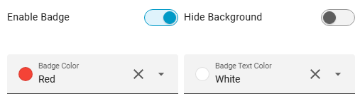

# Display Mode

Choose how the items are displayed. `standard` is the default.

| Display mode | Look |
|--------|------|
| `standard` | Round icon, name and state below |
| `badge` | Compact: icon with a count badge, persons show a home/away icon |
| `chip` | Pill: icon on the left, name and state stacked on the right |

- **Global:** `display_mode` on the card applies to all items
- **Per Item:** set `display_mode` in a domain, device class or smart group customization to override the card display mode
- **Square:** with `square: true`, chips get rounded corners instead of a full pill
- **Scrolling:** chips scroll sideways like the other display modes; `no_scroll: true` wraps them into rows

!!! warning "Breaking change in 4.0"
    `badge_mode: true` was removed. Use `display_mode: badge` instead, on the card and per item.


---

## Editor Settings

| Option | Description |
|--------|-------------|
| **Display mode** | Standard, Badge or Chip (global or per item) |
| **Badge Color** | Badge color, shown when the display mode is Badge |
| **Badge Text Color** | Badge text color, shown when the display mode is Badge |



---

## YAML Example

```yaml
type: custom:status-card
display_mode: chip
customization:
  - type: light
    display_mode: badge
    badge_color: red
    badge_text_color: white
```
