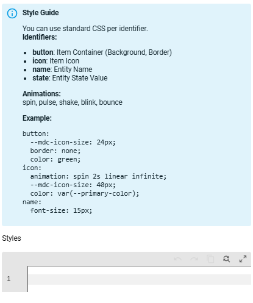

# Styles

Custom CSS for individual elements. Works globally and per item.



- **styles.card:** CSS for the entire card
- **styles.button:** CSS for the buttons
- **styles.icon:** CSS for the icons
- **styles.name:** CSS for the names
- **styles.state:** CSS for the states
- **styles.count:** extra CSS depending on the item count (per item only, see below)

---

## Styles by Count

Domain, device class and smart group items can change their look depending on the number shown on the item. Add a `count` list with levels to the item's `styles`. Each level has a `min` and any of `button`, `icon`, `name`, `state`. The highest level whose `min` is reached wins and is added on top of the normal styles.

```yaml
customization:
  - type: light
    styles:
      icon: "color: var(--primary-color);"
      count:
        - min: 3
          icon: "color: orange;"
        - min: 6
          icon: "color: red; animation: pulse 1s infinite;"
          button: "background: rgba(255,0,0,0.1);"
```

---

## Available Animations

`spin`, `pulse`, `shake`, `blink`, `bounce`

---

## YAML Example

```yaml
styles:
  card: "background-color: rgba(255,0,0,0.1);"
  button: "border: none;"
  icon: "animation: spin 2s linear infinite;"
  name: "font-weight: bold;"
  state: "color: green;"
```
